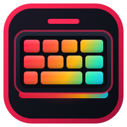

<p align="center">
  
</p>

<h1 align="center">Origins 65 Lighting</h1>

<p align="center">
  RGB lighting control for the <b>HyperX Alloy Origins 65</b> keyboard on Linux.<br>
  Everything NGENUITY's lighting page does, without Windows.
</p>

---

## What you can do

- **Pick from 12 effects** — solid, breathing, colour cycle, wave, swipe, confetti, sun and twilight, plus
  effects that react when you press a key (fade, explosion, flame and implosion).
- **Stack layers** — put a key-press effect on top of a wave, or light just W A S D in a different colour.
- **Save to the keyboard** — store up to three effects in the keyboard's own memory, so they work on any
  computer, even with this app closed.
- **Change brightness and switch slots** right from the app.
- **Keep it running in the background** — close the window and the app stays in your system tray, keeping
  your live effects going. Click the tray icon to bring it back.

The keyboard's own `Fn` brightness keys keep working while the app is running.

## Getting started

### 1. Let your user talk to the keyboard (one time)

Linux only lets programs control USB devices that have been allowed. Paste this into a terminal once, then
unplug and replug the keyboard:

```bash
sudo tee /etc/udev/rules.d/60-origins65.rules <<'EOF'
SUBSYSTEM=="usb", ATTR{idVendor}=="03f0", ATTR{idProduct}=="038f", TAG+="uaccess"
SUBSYSTEM=="hidraw", ATTRS{idVendor}=="03f0", ATTRS{idProduct}=="038f", TAG+="uaccess"
EOF
sudo udevadm control --reload && sudo udevadm trigger
```

(The same rule is in [`udev/60-origins65.rules`](udev/60-origins65.rules) if you'd rather copy the file.)

### 2. Run the app

Download `Origins65-Lighting-x86_64.AppImage` from the [Releases page](../../releases/latest), make it
executable and open it:

```bash
chmod +x Origins65-Lighting-x86_64.AppImage
./Origins65-Lighting-x86_64.AppImage
```

You can also double-click it in your file manager. Want it to start hidden in the tray when you log in?
Add the AppImage to your desktop's autostart list with the `--background` option.

## Good to know

- **Only one program can drive the lighting at a time.** If the app is running (even in the tray), quit it
  from the tray menu before using the command-line tool.
- **Quitting the app** (from the tray menu or with `Ctrl+Q`) hands the lighting back to the keyboard, so
  your saved onboard effect comes back.
- **No tray?** On desktops without a system tray (for example GNOME without the AppIndicator extension),
  closing the window simply quits the app.
- Tested with firmware 21.04 on the US 67-key layout. Other layouts may light the wrong keys.

## Troubleshooting

| Problem | Try this |
|---|---|
| "03f0:038f not found" | Check the keyboard is plugged in directly (not through a KVM switch). |
| A "permission denied" error | Make sure you did step 1, then unplug and replug the keyboard. |
| "failed to claim USB interface 3" | Another copy of the app or the command-line tool is running. Quit it first. |
| The tray icon doesn't show up | Your desktop may not have a system tray. On GNOME, install the *AppIndicator and KStatusNotifierItem Support* extension. |

## Command-line tool

There's also an `origins65` command for scripts and keyboard shortcuts (see *Building from source* to
get it):

```bash
origins65 info                                    # firmware, active slot, saved effects
origins65 live wave                               # show an effect until Ctrl+C
origins65 live explosion:color=random wave        # key-press explosions on top of a wave
origins65 save --slot 0 wave fade:color=white     # store an effect on the keyboard
origins65 brightness 60                           # 0 to 100
origins65 slot 1                                  # switch onboard slot (0, 1 or 2)
origins65 effects                                 # list effects and their speed ranges
origins65 keys                                    # list key names for keys=...
```

Effects are written as `name:option=value,...`, top layer first. Options: `speed`, `color` (`ff0000`, a
colour name, or `random`), `colors=red/green/blue`, `keys=w+a+s+d`, `opacity`, `angle` (wave) and
`direction` (swipe). A saved slot holds up to 120 frames (a 6-second loop) plus one key-press effect:
`fade`, `explosion` or `flame`.

## Building from source

The command-line tool needs only Rust:

```bash
cargo build -p origins65 --release      # → target/release/origins65
```

The desktop app also needs a few system development libraries; see [`gui/README.md`](gui/README.md).
Developer notes for the driver library and its tests are in [`driver/README.md`](driver/README.md), and the
USB protocol is documented in [`docs/origins65-protocol.md`](docs/origins65-protocol.md).

### Building the AppImage

To package the desktop app as a single-file AppImage that runs on most Linux distributions, run the build script where the desktop app's build dependencies are installed (inside the distrobox on Bazzite):

```bash
packaging/build-appimage.sh      # → target/appimage/Origins65-Lighting-x86_64.AppImage
```

The first run downloads linuxdeploy and appimagetool into `~/.cache/appimage-tools`.

## About

This is an independent project, not affiliated with HP or HyperX. The lighting protocol was worked out by
studying how NGENUITY 2.39 talks to the keyboard.

## License

Origins 65 Lighting is free software: you can redistribute it and/or modify it under the terms of the
[GNU General Public License](LICENSE), version 3 or (at your option) any later version. It comes with
no warranty.

The license covers everything in this repository: the driver, the command-line tool, the desktop app
and the Python reference tools.
